<picture><source media="(prefers-color-scheme: dark)" srcset="./assets/header-dark.svg" />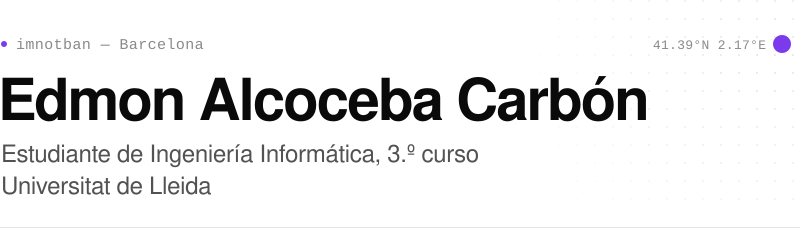</picture>

 

### Sobre mí

Estudio tercero del Grado en Ingeniería Informática en la Universitat de Lleida. Me interesan el desarrollo de software, la inteligencia artificial y el desarrollo web.

En mis repositorios hay prácticas de la carrera —algorítmica, estructuras de datos, redes y autómatas— y proyectos web propios.

Catalán y castellano (nativo) · Inglés (B2) · Alemán (básico)

 

### Tecnologías

<picture><source media="(prefers-color-scheme: dark)" srcset="./assets/stack/lenguajes-dark.svg" />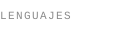</picture>
<picture><source media="(prefers-color-scheme: dark)" srcset="./assets/stack/java-dark.svg" />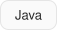</picture>
<picture><source media="(prefers-color-scheme: dark)" srcset="./assets/stack/python-dark.svg" />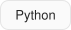</picture>
<picture><source media="(prefers-color-scheme: dark)" srcset="./assets/stack/c-dark.svg" /></picture>
<picture><source media="(prefers-color-scheme: dark)" srcset="./assets/stack/cpp-dark.svg" />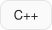</picture>
<picture><source media="(prefers-color-scheme: dark)" srcset="./assets/stack/typescript-dark.svg" />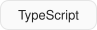</picture>
<picture><source media="(prefers-color-scheme: dark)" srcset="./assets/stack/assembly-dark.svg" />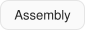</picture>

<picture><source media="(prefers-color-scheme: dark)" srcset="./assets/stack/web-dark.svg" />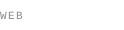</picture>
<picture><source media="(prefers-color-scheme: dark)" srcset="./assets/stack/next-js-dark.svg" />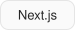</picture>
<picture><source media="(prefers-color-scheme: dark)" srcset="./assets/stack/react-dark.svg" />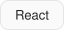</picture>
<picture><source media="(prefers-color-scheme: dark)" srcset="./assets/stack/flask-dark.svg" />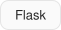</picture>
<picture><source media="(prefers-color-scheme: dark)" srcset="./assets/stack/html-dark.svg" />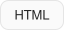</picture>
<picture><source media="(prefers-color-scheme: dark)" srcset="./assets/stack/css-dark.svg" />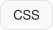</picture>

<picture><source media="(prefers-color-scheme: dark)" srcset="./assets/stack/herramientas-dark.svg" />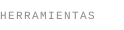</picture>
<picture><source media="(prefers-color-scheme: dark)" srcset="./assets/stack/git-dark.svg" />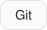</picture>
<picture><source media="(prefers-color-scheme: dark)" srcset="./assets/stack/bash-dark.svg" />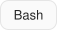</picture>
<picture><source media="(prefers-color-scheme: dark)" srcset="./assets/stack/linux-dark.svg" />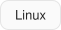</picture>

 

### Proyecto destacado

<a href="https://montserrat-viva.vercel.app/"><picture><source media="(prefers-color-scheme: dark)" srcset="./assets/project-dark.svg" />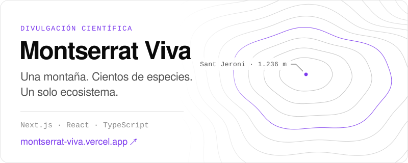</picture></a>

Mi TDR de bachillerato convertido en web: una guía de divulgación sobre la biodiversidad de Montserrat. Reúne un atlas con 50 fichas de fauna y flora, la red de relaciones del ecosistema y la historia geológica de la montaña.

 

### Lenguajes

<picture><source media="(prefers-color-scheme: dark)" srcset="https://raw.githubusercontent.com/ImNotBan/ImNotBan/output/languages-dark.svg" /></picture>

Calculado a diario con GitHub Actions a partir de mis repositorios públicos.

 

### Contacto

[edmonalkoceba21@gmail.com](mailto:edmonalkoceba21@gmail.com)
<!-- LinkedIn: añade aquí el enlace cuando quieras, p. ej. · [LinkedIn](https://www.linkedin.com/in/…) -->

In English

 

Third-year Computer Engineering student at the Universitat de Lleida, based in Barcelona. Interested in software development, artificial intelligence and web development. Featured project: [Montserrat Viva](https://montserrat-viva.vercel.app/), a website about the biodiversity of Montserrat. Languages: Catalan and Spanish (native), English (B2), German (basic).

