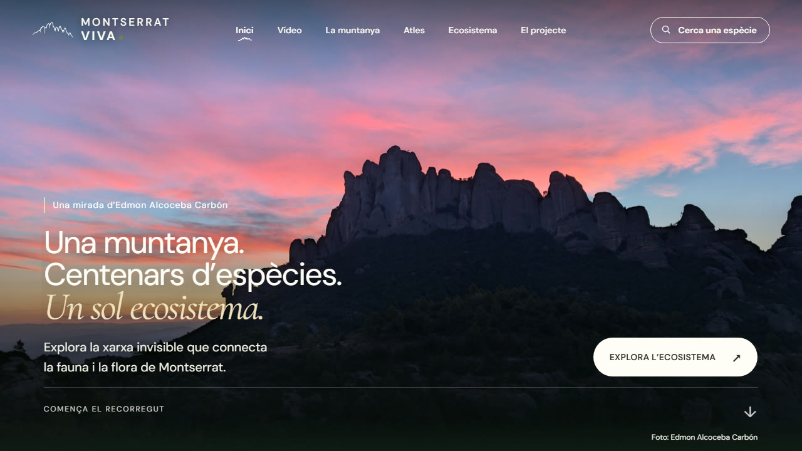

## Hola, soy Edmon 👋

Estudiante de **Ingeniería Informática** en la [Universitat de Lleida](https://www.udl.cat/).

### Con qué trabajo

  

### Proyecto destacado

**[Montserrat Viva](https://montserrat-viva.vercel.app/)**: una web que explora la red invisible que conecta la fauna y la flora de Montserrat. Hecha con Next.js, React y TypeScript.

### En números

<picture>
  <source media="(prefers-color-scheme: dark)" srcset="https://raw.githubusercontent.com/ImNotBan/ImNotBan/output/languages-dark.svg" />
  
</picture>

---

📫 [edmonalkoceba21@gmail.com](mailto:edmonalkoceba21@gmail.com)
