 

 

## Estadísticas

  <picture>
    <source media="(prefers-color-scheme: dark)" srcset="https://github-readme-stats.vercel.app/api?username=ImNotBan&show_icons=true&include_all_commits=true&rank_icon=github&hide_border=true&bg_color=00000000&title_color=a78bfa&text_color=c9d1d9&icon_color=a78bfa" />
    
  </picture>
  <picture>
    <source media="(prefers-color-scheme: dark)" srcset="https://github-readme-stats.vercel.app/api/top-langs/?username=ImNotBan&layout=compact&langs_count=8&hide_border=true&bg_color=00000000&title_color=a78bfa&text_color=c9d1d9&icon_color=a78bfa" />
    
  </picture>
   
  <picture>
    <source media="(prefers-color-scheme: dark)" srcset="https://streak-stats.demolab.com?user=ImNotBan&hide_border=true&background=00000000&ring=7C3AED&fire=8B5CF6&currStreakNum=A78BFA&sideNums=A78BFA&currStreakLabel=A78BFA&sideLabels=A78BFA&dates=8B949E&stroke=30363D" />
    
  </picture>

  <picture>
    <source media="(prefers-color-scheme: dark)" srcset="https://raw.githubusercontent.com/ImNotBan/ImNotBan/output/snake-dark.svg" />
    
  </picture>

## Contacto

<!-- LINKEDIN_URL: sustituye la URL y descomenta la línea siguiente -->
<!--  -->

<b>In English</b>

 

Third-year Computer Engineering student at the Universitat de Lleida, based in Barcelona.
Interested in artificial intelligence, software development and web development.
Looking for IT internships compatible with my studies.
Languages: Catalan and Spanish (native), English (B2), German (basic).

