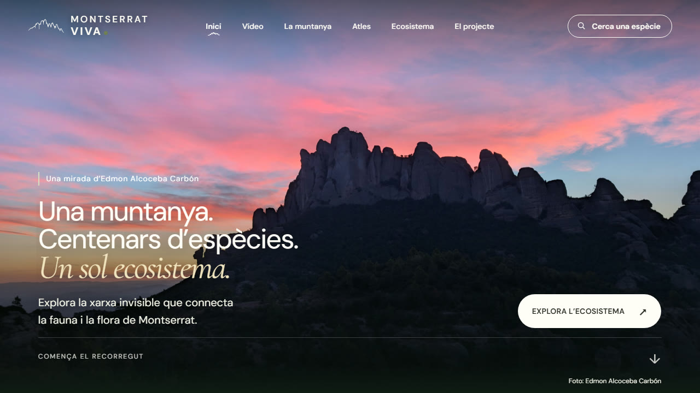
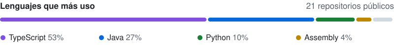

## Hola, sóc l'Edmon 👋

Estudiant de la [Universitat de Lleida (UdL)](https://www.udl.cat/).

### Amb què treballo

  

### Projecte destacat

**[Montserrat Viva](https://montserrat-viva.vercel.app/)**: una web que explora la xarxa invisible que connecta la fauna i la flora de Montserrat. Feta amb Next.js, React i TypeScript.

### En xifres

<picture>
  <source media="(prefers-color-scheme: dark)" srcset="https://raw.githubusercontent.com/ImNotBan/ImNotBan/output/languages-dark.svg" />
  
</picture>

---

📫 [edmonalkoceba21@gmail.com](mailto:edmonalkoceba21@gmail.com)
